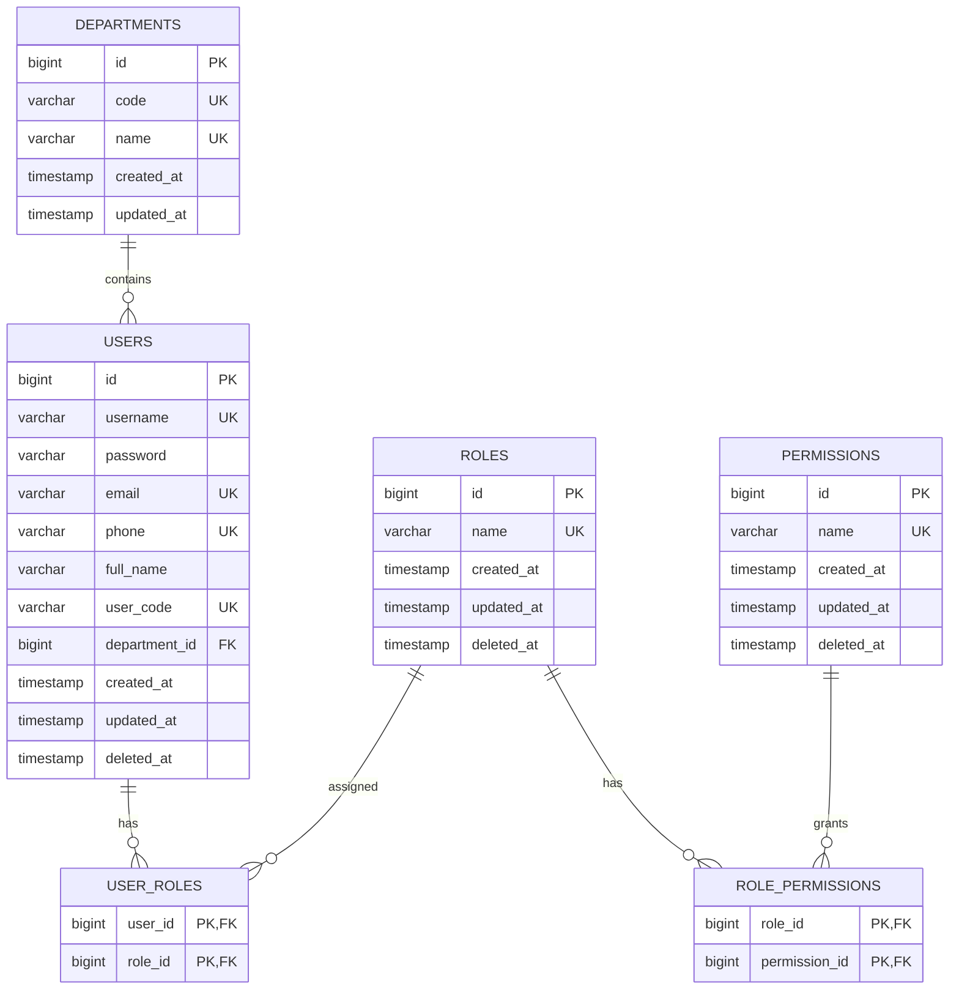
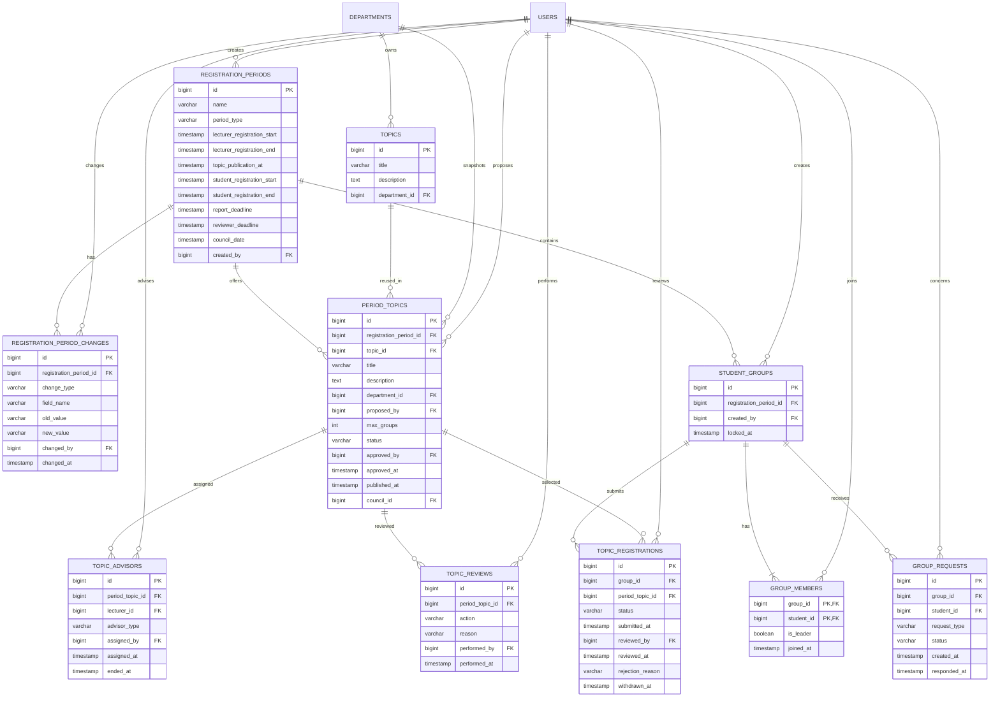
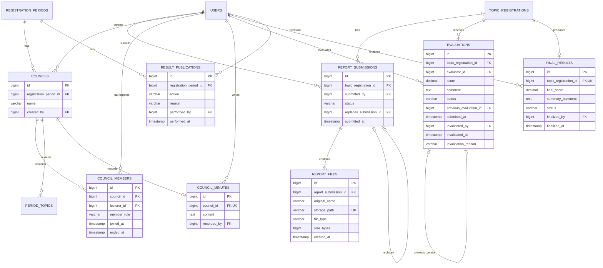
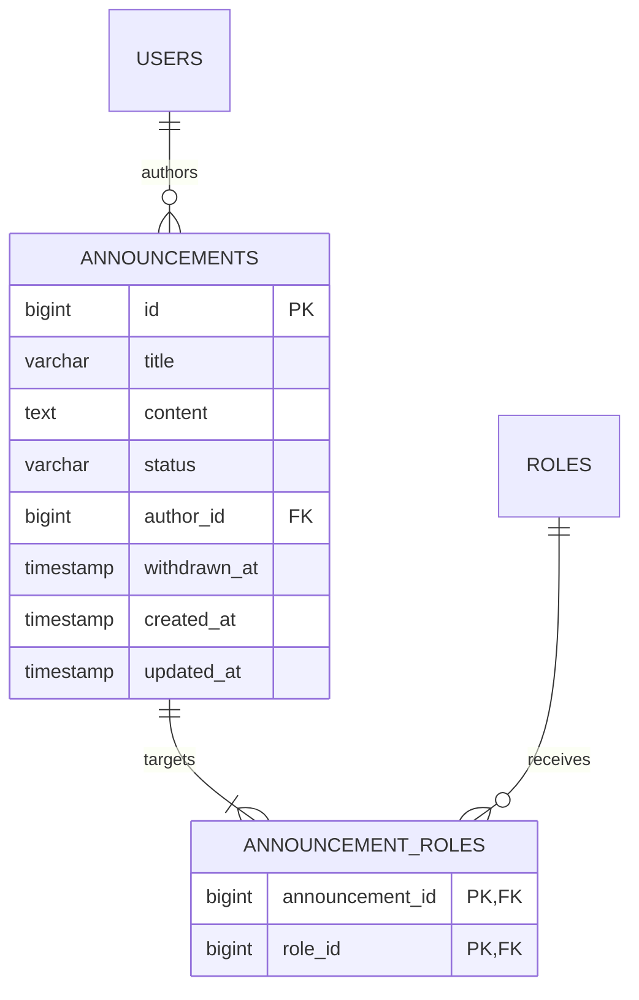

# Sơ đồ quan hệ cơ sở dữ liệu

Tài liệu này minh họa các quan hệ trong thiết kế tại [db.md](db.md). Sơ đồ được tách theo miền để dễ đọc và trình bày khi bảo vệ đồ án.

Quy ước:

- `PK`: khóa chính.
- `FK`: khóa ngoại.
- `UK`: khóa duy nhất.
- Các bảng lịch sử giữ bản ghi cũ, không bị xóa khi trạng thái nghiệp vụ thay đổi.
- Sinh viên và giảng viên đều là `USERS`; role xác định quyền của tài khoản.

## 1. Danh tính và phân quyền



## 2. Đợt, đề tài, nhóm và đăng ký



## 3. Báo cáo, hội đồng, đánh giá và kết quả



## 4. Thông báo



## 5. Luồng dữ liệu chính

```text
RegistrationPeriod
    └── PeriodTopic ── Topic
          ├── TopicAdvisor
          └── Council

RegistrationPeriod
    └── StudentGroup
          └── GroupMember
          └── TopicRegistration ── PeriodTopic
                ├── ReportSubmission ── ReportFile
                ├── Evaluation
                └── FinalResult

RegistrationPeriod
    └── ResultPublication
```

Điểm quan trọng của quan hệ trên là báo cáo, đánh giá và kết quả đều gắn với `topic_registrations`. Vì vậy dữ liệu luôn xác định được nhóm nào thực hiện đề tài nào trong đợt nào, kể cả khi cùng một nội dung đề tài được tái sử dụng ở nhiều đợt.
